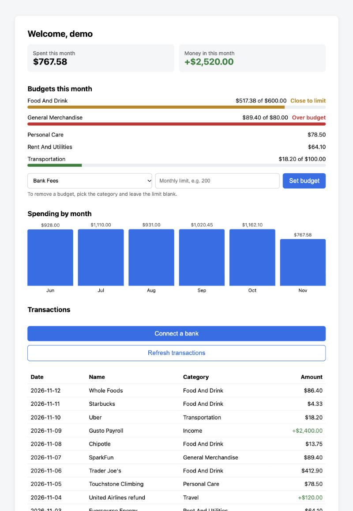
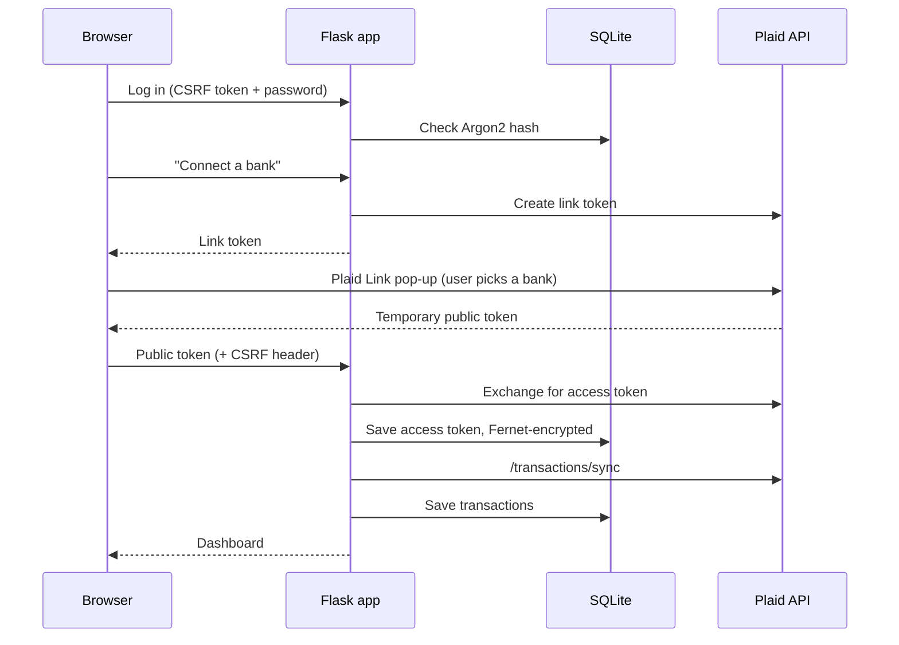

# Secure Budget App

[](https://github.com/BrianLi200777/secure-budget-app/actions/workflows/ci.yml)

A personal budgeting app that connects to bank accounts through the [Plaid API](https://plaid.com/docs/), built with security as the main focus. Bank access tokens are encrypted at rest, passwords are hashed with Argon2, and every form is protected against CSRF.

**Live demo:** https://secure-budget-app.onrender.com

> **Try it:** log in as `demo` / `try-the-demo` to see sample data, or create your own account and click **Connect a bank** (Plaid's test login is `user_good` / `pass_good`).
>
> Runs in Plaid's **Sandbox**: it only connects to Plaid's test banks with fake data. It never touches real bank accounts. The demo account is shared by everyone who uses it.
>
> The demo is on Render's free plan, so the first visit may take about a minute to wake up, and the database resets when the service restarts (the demo account is re-created each time).



*Screenshot uses made-up demo data.*

## Features

- **Connect a bank** with Plaid Link, Plaid's official bank-connection pop-up.
- **Transaction sync** using Plaid's `/transactions/sync`, which remembers where it left off, so a refresh only fetches what's new.
- **Monthly summary** of money spent and money received.
- **Per-category budgets** with warnings at 80% ("Close to limit") and 100% ("Over budget").
- **Spending chart** for the last 6 months.

## Security

| Threat | Defense | Where |
|---|---|---|
| Stolen database exposes passwords | Passwords hashed with **Argon2id** (memory-hard, resists GPU cracking). Hashes upgrade automatically when settings change. | `register()`, `login()` in [app.py](app.py) |
| Stolen database exposes bank access | Plaid access tokens **encrypted with Fernet** (AES + HMAC) before they're saved. The key lives only in `.env`. | `exchange_public_token()` |
| SQL injection | Every query uses **parameterized `?` placeholders**. User input is never put into SQL text. | All queries |
| Cross-site request forgery (CSRF) | **Flask-WTF CSRF tokens** on every form, plus an `X-CSRFToken` header on JavaScript requests. | `CSRFProtect`, [static/app.js](static/app.js) |
| Password guessing | **Rate limit**: 5 login attempts per minute per IP (Flask-Limiter). | `login()` |
| Username discovery | The same "Invalid username or password" message whether the user exists or not. | `login()` |
| Session fixation | The session is cleared and rebuilt on every login. | `login()` |
| Cross-site scripting (XSS) | Jinja auto-escaping, plus a **Content-Security-Policy** that allows scripts only from this app and Plaid and **blocks all inline scripts**. | `set_security_headers()` |
| Clickjacking | `frame-ancestors 'none'` and `X-Frame-Options: DENY`. | `set_security_headers()` |
| Cookie theft | Session cookie is `HttpOnly` and `SameSite=Lax`, and `Secure` (HTTPS-only) in production. HSTS is on in production. | App config |
| Sensitive data in browser cache | `Cache-Control: no-store` on every response. | `set_security_headers()` |
| Leaking error details | Plaid errors are logged on the server. Users only see a generic message. | Plaid routes |
| Bad input | Budget limits checked on the server (rejects text, negatives, `nan`, `inf`, huge values). Categories must come from a fixed list. | `set_budget()` |
| Secrets in the repo | All keys live in `.env`, which is in `.gitignore`. [.env.example](.env.example) shows only placeholders. | — |
| Vulnerable code or packages | CI runs **bandit** (static security analysis) and **pip-audit** (known-vulnerability check) on every push. | [ci.yml](.github/workflows/ci.yml) |

## How it works



## Tech stack

Python 3.14 · Flask · SQLite · Plaid API · Argon2 (`argon2-cffi`) · Fernet (`cryptography`) · Flask-WTF · Flask-Limiter · pytest · bandit · pip-audit · GitHub Actions

## Run it locally

You'll need Python 3.11+ and a free [Plaid developer account](https://dashboard.plaid.com/signup) for Sandbox keys.

```bash
git clone https://github.com/BrianLi200777/secure-budget-app.git
cd secure-budget-app
python3 -m venv venv
source venv/bin/activate
pip install -r requirements.txt
cp .env.example .env
```

Fill in `.env`:

- `PLAID_CLIENT_ID` and `PLAID_SECRET`: from the Plaid dashboard (use the **Sandbox** secret).
- `FLASK_SECRET_KEY`: generate one with `python -c "import secrets; print(secrets.token_hex(32))"`
- `FERNET_KEY`: generate one with `python -c "from cryptography.fernet import Fernet; print(Fernet.generate_key().decode())"`

Then run:

```bash
python app.py
```

Open http://127.0.0.1:5001, create an account, and click **Connect a bank**. In the Plaid pop-up, use Plaid's test login: `user_good` / `pass_good`.

## Tests and security checks

```bash
pip install pytest bandit pip-audit
python -m pytest            # 27 tests; uses a fake Plaid and a temporary database
bandit -r app.py            # static security analysis
pip-audit -r requirements.txt   # known vulnerabilities in dependencies
```

The tests cover login, password hashing, token encryption, transaction sync, budget math, CSRF, security headers, cookie flags, rate limiting, and making sure users can't see each other's data.

## Roadmap

- [ ] Threat model write-up (STRIDE)
- [ ] Two-factor login (TOTP)
- [x] Deploy a live demo (Render, gunicorn, HTTPS-only cookies, HSTS)
